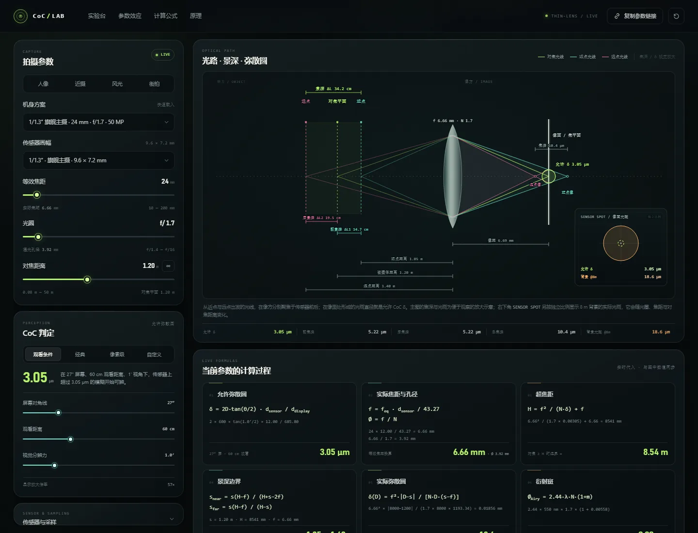

# CoC Lab



面向手机摄影的交互式弥散圆（Circle of Confusion）实验台。调整传感器、等效焦距、光圈、对焦距离和观看条件，实时观察：

- 允许 CoC 阈值、超焦距与景深边界
- 实际几何弥散圆随物距的变化
- 艾里斑、像素采样与衍射极限
- 教科书式动态光路图：近点 / 远点 / 像面光斑 / 前焦深 / 后焦深
- 随参数实时变化的公式代入过程
- 三层景深取景模拟
- 单参数变化对背景虚化、景深、视角和衍射的影响

## 运行

```bash
npm start
```

默认地址：<http://127.0.0.1:4173>。可通过 `PORT` 和 `HOST` 环境变量修改。

```bash
PORT=8080 HOST=0.0.0.0 npm start
```

Windows PowerShell：

```powershell
$env:PORT=8080; $env:HOST='0.0.0.0'; npm start
```

## 学习资料

- [CoC 零基础学习指南](docs/CoC-零基础学习指南.md)：从生活比喻、术语表、参数效应到公式代入的完整入门文档，适合第一次接触景深和弥散圆的人。

## 测试

```bash
npm test
npm run check
```

测试覆盖 Crop Factor、四种 CoC 判据、超焦距、景深边界、实际弥散圆、无限远对焦、衍射与滑杆映射。

## 结构

```
public/
  index.html          页面结构
  css/styles.css      视觉系统与响应式布局
  js/optics.js        薄透镜光学模型（纯函数）
  js/viz.js           SVG 光路图、图表与 Canvas 景深预览
  js/app.js           状态、交互、URL 分享与渲染
tests/optics.test.mjs 光学模型单元测试
docs/
  CoC-零基础学习指南.md  面向初学者的 CoC / 景深学习文档
server.mjs            零依赖静态服务器
```

## 模型与边界

采用一阶薄透镜、几何光学近似，波长取 550 nm。忽略镜头像差、对焦呼吸、多帧合成、计算虚化和景深算法。页面中的“允许 CoC”是可接受模糊的感知阈值，不等同于镜头产生的真实弥散圆。

参数会写入 URL 查询串，可复制链接分享当前实验状态。
